<div align="center">

  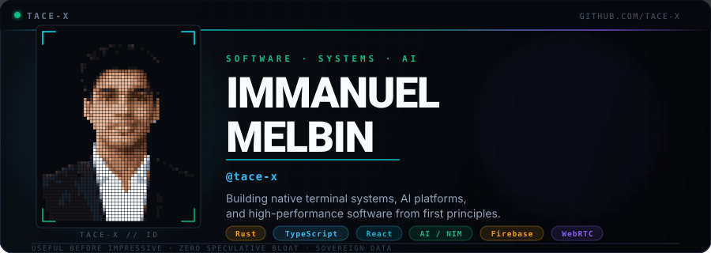

  <br /><br />

  <a href="#selected-projects"><strong>🚀 SELECTED PROJECTS</strong></a>
  &nbsp;•&nbsp;
  <a href="#arcade-defender"><strong>👾 ARCADE DEFENDER</strong></a>
  &nbsp;•&nbsp;
  <a href="#engineering-arsenal"><strong>⚡ TECH ARSENAL</strong></a>
  &nbsp;•&nbsp;
  <a href="#production-systems"><strong>📦 PRODUCTION SUITES</strong></a>
  &nbsp;•&nbsp;
  <a href="#engineering-manifesto"><strong>🧭 ENGINEERING LOOP</strong></a>
  &nbsp;•&nbsp;
  <a href="#telemetry--activity"><strong>📊 TELEMETRY</strong></a>
  &nbsp;•&nbsp;
  <a href="https://github.com/tace-x?tab=repositories"><strong>🌐 ALL REPOSITORIES</strong></a>

  <br /><br />

  <sub>
    <a href="#identity">Identity</a> &nbsp;·&nbsp;
    <a href="#arcade-defender">Arcade Defender</a> &nbsp;·&nbsp;
    <a href="#terminalvision">TerminalVision</a> &nbsp;·&nbsp;
    <a href="#capcam">CAPCAM</a> &nbsp;·&nbsp;
    <a href="#nocap">NOCAP</a> &nbsp;·&nbsp;
    <a href="#kalvichat">Kalvichat</a> &nbsp;·&nbsp;
    <a href="#typetasks">TypeTasks</a> &nbsp;·&nbsp;
    <a href="#project-alpha">Project Alpha</a> &nbsp;·&nbsp;
    <a href="#production-systems">Production Suites</a> &nbsp;·&nbsp;
    <a href="#engineering-arsenal">Tech Stack</a> &nbsp;·&nbsp;
    <a href="#telemetry--activity">Activity</a> &nbsp;·&nbsp;
    <a href="#transmission">Connect</a>
  </sub>

</div>

---

<a id="identity"></a>
<a id="-identity"></a>

## 01 // IDENTITY & COCKPIT

<div align="center">

  <picture>
    <source media="(prefers-reduced-motion: reduce)" srcset="assets/portrait/portrait_dotmatrix.svg" />
    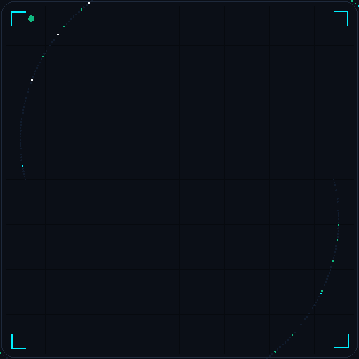
  </picture>

  <br />

  <sub>
    <b>TACE-X // IDENTITY MATRIX</b> &nbsp;•&nbsp;
    <code>64x64 DOT-MATRIX</code> &nbsp;•&nbsp;
    <code>HOLOGRAPHIC PARTICLE ASSEMBLY</code>
  </sub>

  <br />

  <sub>
    <i>Temporary geometric architect emblem — <a href="docs/PORTRAIT_PIPELINE.md#-how-to-regenerate-assets-with-your-photo">custom portrait pipeline ready</a></i>
  </sub>

  <br /><br />

  <a href="https://github.com/tace-x/TerminalVision"></a>
  &nbsp;
  <a href="https://github.com/tace-x/CAPCAM"></a>
  &nbsp;
  <a href="https://github.com/tace-x/NOCAP"></a>
  &nbsp;
  <a href="https://github.com/tace-x/Kalvichat"></a>
  &nbsp;
  <a href="https://github.com/tace-x/TypeTasks"></a>

</div>

<br />

```bash
┌──(tace-x@cockpit)-[~]
└─$ tace-x --status --manifest
{
  "developer": "Immanuel Melbin",
  "handle": "@tace-x",
  "status": "Compiling, testing & shipping verified software",
  "flagship_systems": [
    "TerminalVision — Native Rust terminal file manager & live Unix PTY",
    "CAPCAM — Chrome MV3 offscreen WebRTC canvas media pipeline",
    "NOCAP — Rumour intelligence & verification desk (NVIDIA NIM / Gemma 4)",
    "Kalvichat — Privacy-first real-time platform (React 19 / Firestore)",
    "TypeTasks — Keyboard-driven local-first task engine (TypeScript / Vite)"
  ],
  "verified_toolchain": ["Rust 2024", "TypeScript", "React 19", "Unix PTY", "NVIDIA NIM", "Firebase"],
  "engineering_ethos": "Useful before impressive. Zero-allocation hot paths. Sovereign data."
}
```

> **Systems Architect. Full-Stack Engineer. Sovereign Builder.**  
> I design and engineer end-to-end software—spanning the bare-metal ergonomics of native terminal cockpits, high-stakes decision intelligence platforms, and local-first workspaces. Every project is built from first principles with measured performance, rock-solid type safety, and zero speculative bloat.

<br />

---

<a id="arcade-defender"></a>
<a id="-arcade-defender"></a>

## 02 // SIGNATURE CONTRIBUTION SPACE DEFENDER

<div align="center">

  <picture>
    <source media="(prefers-reduced-motion: reduce)" srcset="assets/arcade/arcade_poster.svg" />
    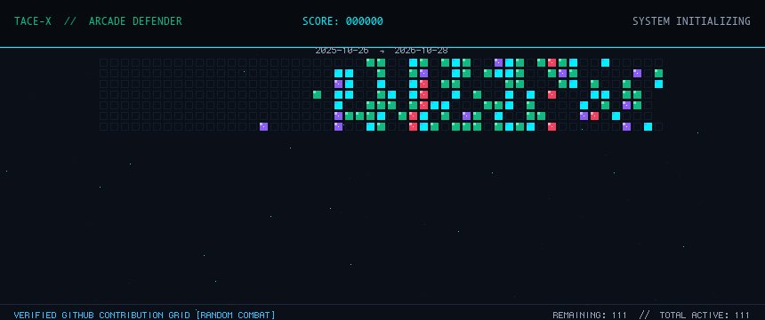
  </picture>

  <br />

  <sub>
    <b>TACE-X // ARCADE DEFENDER</b> &nbsp;•&nbsp;
    <code>53 WEEKS // 371 CELLS</code> &nbsp;•&nbsp;
    <code>VERIFIED SCORE: 4,070 PTS</code> &nbsp;•&nbsp;
    <a href="standalone/index.html"><b>▶ LAUNCH INTERACTIVE RETRO SHOOTER IN BROWSER</b></a>
  </sub>

</div>

<br />

> **Gamified Contribution Telemetry:** The $53 \times 7$ contribution matrix is rendered as an armada of retro invaders where color, armor, and point values map 1:1 to verified commit intensity: Mint Scouts (Level 1, +10 pts), Cyan Escorts (Level 2, +25 pts), Violet Battlecruisers (Level 3, +50 pts), and Threat Red Motherships (Level 4, +100 pts). Score formula: $\text{Base Score } (1,670) + \text{Clearance Bonus } (480 \times 5 = 2,400) = \mathbf{4,070\text{ PTS}}$.

<br />

---

<a id="selected-projects"></a>
<a id="-selected-projects"></a>
<a id="flagship-systems"></a>
<a id="-flagship-systems"></a>

## 03 // SELECTED PROJECTS & FLAGSHIP SYSTEMS

A curated breakdown of top-tier systems engineered, verified, and shipped on GitHub. Each project is evaluated on technical depth, architectural originality, practical utility, and code implementation evidence.

<br />

<a id="terminalvision"></a>
<a id="-terminalvision"></a>

### 01 — TerminalVision <sub>[Native Systems &amp; Rust 2024]</sub>

<a href="https://github.com/tace-x/TerminalVision">
  
</a>

<br />

**TerminalVision** is a high-performance, native Rust terminal file manager, developer cockpit, and integrated interactive shell environment. It fuses side-by-side dual-pane navigation, syntax-highlighted code preview, image and media inspection, in-process Git analytics, an asynchronous storage analyzer, and a **real, live Unix PTY terminal** always visible and ready for seamless keyboard and mouse control.

```bash
# Clone and build native binary
git clone https://github.com/tace-x/TerminalVision.git
cd TerminalVision && cargo run --release
```

- **⚡ Live Interactive Unix PTY:** Embedded pseudo-terminal running `zsh`, `bash`, `fish`, or `sh` with instant focus toggling (`Ctrl+T` / `F12`). Run `vim`, `nano`, `top`, or `ssh` right inside the cockpit without process suspension.
- **📁 Dual-Pane Virtual File System:** Side-by-side independent navigation panes with active indicators, fast multi-selection (`Space`, `⌘A`), and instantaneous zero-allocation sorting.
- **🖼️ Universal Terminal Graphics:** Kitty, iTerm2, and Sixel protocol image rendering for PNG, JPEG, GIF, BMP, and WEBP with fallback ASCII and metadata cards.
- **📊 Storage Vision Heatmap:** Background non-blocking directory scanner with real-time usage heatmap bars and top memory consumer breakdown.
- **🛡️ Bounded Safe Previews:** Syntax highlighting across 20+ programming languages with memory guards preventing OOM spikes on multi-gigabyte files.
- **🧪 Implementation Verification:** 21 comprehensive integration and fuzz test suites under `tests/` verifying state machines, PTY lifecycle, and layout engines.

[**INSPECT REPOSITORY →**](https://github.com/tace-x/TerminalVision) &nbsp;•&nbsp; `RUST 2024` · `RATATUI` · `UNIX PTY` · `CROSSTERM` · `LIBC`

<br />

---

<a id="capcam"></a>
<a id="-capcam"></a>

### 02 — CAPCAM <sub>[Browser Systems &amp; WebRTC Media Pipeline]</sub>

<a href="https://github.com/tace-x/CAPCAM">
  
</a>

<br />

**CAPCAM** is a local-first Chrome Manifest V3 extension architected to intercept and substitute WebRTC camera sender tracks via an offscreen canvas rendering engine. Built to operate entirely inside the client sandbox with zero telemetry or cloud transmission, it delivers fluid real-time video compositing directly to browser-based video conferencing peers.

- **🎥 Offscreen Canvas Media Pipeline:** Routes video frames into Chrome's Offscreen Document API context, maintaining a rock-steady 60 FPS without degrading UI responsiveness or blocking the main extension service worker.
- **🔄 In-Place Sender Track Replacement:** Leverages WebRTC's `RTCRtpSender.replaceTrack()` to hot-swap live camera streams seamlessly without breaking active peer connections.
- **🔒 Local-First Sovereignty:** 100% operational offline with zero external network requests, preserving user privacy and confidential media streams.
- **🧪 Implementation Verification:** 15 modular unit and integration test suites under `tests/` verifying canvas transformations, messaging conduits, stress conditions, and WebRTC stream substitution.

[**INSPECT REPOSITORY →**](https://github.com/tace-x/CAPCAM) &nbsp;•&nbsp; `TYPESCRIPT` · `CHROME EXTENSION MV3` · `WEBRTC` · `OFFSCREEN API` · `VITEST`

<br />

---

<a id="nocap"></a>
<a id="-nocap"></a>

### 03 — NO CAP (TruthLens) <sub>[Rumour Intelligence &amp; AI Verification]</sub>

<a href="https://github.com/tace-x/NOCAP">
  
</a>

<br />

**NO CAP (TruthLens)** is an automated rumour intelligence desk and verification engine engineered to dissect viral social claims, extract factual predicates, and compute mathematical credibility scores. Powered by accelerated NVIDIA NIM endpoints and Google Gemma 4 models, it brings forensic accountability to high-velocity information streams.

- **🧠 NVIDIA NIM Acceleration:** High-throughput, low-latency neural inference powered by Google Gemma 4 models through optimized NVIDIA NIM microservice endpoints.
- **⚡ Modular Serverless Pipeline:** Decoupled serverless API architecture in `api/ai/` (`check.ts`, `enhance.ts`, `similarity.ts`, `synthesize.ts`) providing zero-latency edge evaluation.
- **📊 Cosine Similarity & Fact Clustering:** Vectorized claim entity matching and cross-referencing to isolate factual discrepancies and quantify hallucination risk.
- **🎯 Calibrated Veracity Index:** Produces transparent, mathematically bounded truth probability scores accompanied by cited factual evidence.

[**INSPECT REPOSITORY →**](https://github.com/tace-x/NOCAP) &nbsp;•&nbsp; `TYPESCRIPT` · `REACT 19` · `NVIDIA NIM` · `GEMMA 4` · `TAILWIND CSS V4`

<br />

---

<a id="kalvichat"></a>
<a id="-kalvichat"></a>

### 04 — Kalvichat <sub>[Secure Distributed Platform &amp; React 19]</sub>

<a href="https://github.com/tace-x/Kalvichat">
  
</a>

<br />

**Kalvichat** is a privacy-first, real-time communication platform engineered for secure educational and organizational messaging. Combining React 19 with Cloud Firestore's real-time streaming engine, it delivers fine-grained administrative moderation, identity resolution, and hardened audit logging.

- **⚡ React 19 Concurrent Streaming:** Low-latency client architecture leveraging React 19 transitions and optimistic updates for instantaneous message dispatch.
- **🔐 Granular Security Infrastructure:** Complete declarative security matrix (`firestore.rules`) and indexed compound queries (`firestore.indexes.json`) enforcing role-based permissions.
- **🛡️ Server-Authorized Admin Moderation:** Serverless backend functions handling sensitive user elevation, chat channel provisioning, and abuse mitigation.
- **🧪 Implementation Verification:** Automated test suites in `tests/` executed via Node's native test runner (`node --test`), validating access rules and message serialization.

[**INSPECT REPOSITORY →**](https://github.com/tace-x/Kalvichat) &nbsp;•&nbsp; `JAVASCRIPT / TYPESCRIPT` · `REACT 19` · `CLOUD FIRESTORE` · `FIREBASE AUTH` · `SERVERLESS`

<br />

---

<a id="typetasks"></a>
<a id="-typetasks"></a>

### 05 — TypeTasks <sub>[Flow Workspace &amp; Local-First Task Engine]</sub>

<a href="https://github.com/tace-x/TypeTasks">
  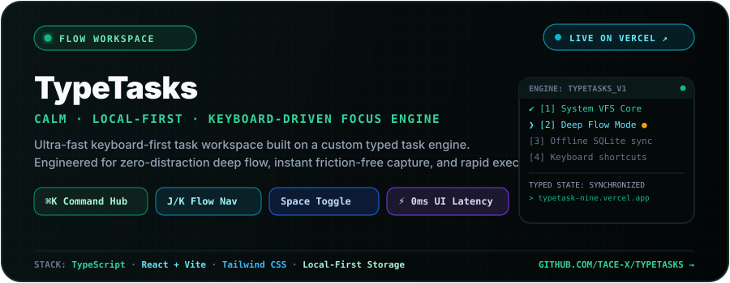
</a>

<br />

**TypeTasks** is a calm, local-first, ultra-fast keyboard-driven task workspace engineered for sustained developer focus. Designed around a custom typed task engine, it completely eliminates mouse dependency during task creation, priority organization, and sprint execution.

- **⚡ Sub-Millisecond Dispatch:** Zero-lag keyboard interaction model featuring a centralized command hub (`⌘K`), vim-inspired flow keys (`J`/`K`), and instant status toggles (`Space`).
- **📦 Sovereign Local-First Architecture:** 100% operational offline with instant local storage persistence and zero network latency on mutation loops.
- **🎨 Distraction-Free Aesthetic:** Tailored dark ambient tokens and fluid CSS micro-transitions engineered to minimize cognitive overhead and protect deep flow state.
- **🧪 Production Verification:** Validated with Vitest unit tests; live verified deployment actively serving users on Vercel.

[**EXPLORE SOURCE →**](https://github.com/tace-x/TypeTasks) &nbsp;•&nbsp; [**LAUNCH LIVE DEMO ↗**](https://typetask-nine.vercel.app) &nbsp;•&nbsp; `TYPESCRIPT` · `REACT 18.3` · `VITE 8` · `VITEST` · `LOCAL-FIRST`

<br />

---

<a id="project-alpha"></a>
<a id="-project-alpha"></a>
<a id="decision-intelligence--ai"></a>
<a id="-decision-intelligence--ai"></a>

### 06 — Project Alpha <sub>[AI &amp; High-Stakes Decision Intelligence]</sub>

<a href="https://github.com/tace-x/Project-Alpha">
  
</a>

<br />

> *"ChatGPT answers. Claude reasons. Project Alpha challenges."*

**Project Alpha** is an AI-powered decision intelligence platform architected for critical scenarios where **being wrong is expensive**. Instead of generating passive answers, Alpha stress-tests the decision, models hidden failure modes, explores counter-scenarios, and produces a hardened, probabilistic verdict.

- **🎯 The Alpha Reasoning Pipeline:** `Decision` ➔ `Analyze` ➔ `Challenge` ➔ `Simulate` ➔ `Verdict` ➔ `Monitor`
- **⚔️ Adversarial AI Evaluation:** Multi-agent counter-analysis that proactively uncovers cognitive biases, unstated assumptions, and tail-risk failure modes.
- **📈 Risk Surface Simulation:** Explores probabilistic multi-scenario futures to evaluate decision durability before resources are committed.

[**INSPECT REPOSITORY →**](https://github.com/tace-x/Project-Alpha) &nbsp;•&nbsp; `TYPESCRIPT` · `REACT 18` · `EXPRESS` · `FIREBASE ADMIN` · `ADVERSARIAL EVALUATION`

<br />

---

<a id="production-systems"></a>
<a id="-production-systems"></a>
<a id="more-systems"></a>
<a id="-more-systems"></a>

## 04 // PRODUCTION SYSTEMS & DOMAIN SUITES

Beyond core flagships, these verified applications and service engines power operations across data-centre management, healthcare logistics, education finance, and offline governance:

<table>
  <thead>
    <tr>
      <th align="left">System / Repository</th>
      <th align="left">Domain</th>
      <th align="left">Architectural Highlights</th>
      <th align="center">Stack</th>
      <th align="right">Verified Repository</th>
    </tr>
  </thead>
  <tbody>
    <tr>
      <td><a href="https://github.com/tace-x/Kalopsia"><strong>Kalopsia</strong></a></td>
      <td>Data-Centre Operations</td>
      <td>Multi-tenant operations platform tracking service entries, recoveries, automatic payment status, and analytics suites.</td>
      <td><code>Firestore</code> <code>JavaScript</code> <code>Chart.js</code></td>
      <td align="right"><a href="https://github.com/tace-x/Kalopsia"><strong>Source →</strong></a></td>
    </tr>
    <tr>
      <td><a href="https://github.com/tace-x/kalopsia-paliative"><strong>kalopsia-paliative</strong></a></td>
      <td>Healthcare Logistics</td>
      <td>Firebase-backed service management engine covering medical equipment inventory, rental declarations, and clients.</td>
      <td><code>Firebase</code> <code>JavaScript</code> <code>HTML5</code></td>
      <td align="right"><a href="https://github.com/tace-x/kalopsia-paliative"><strong>Source →</strong></a></td>
    </tr>
    <tr>
      <td><a href="https://github.com/tace-x/St.Annes-ICSE-School-Payment-Portal"><strong>St. Annes Fee Portal</strong></a></td>
      <td>FinTech / EdTech</td>
      <td>Multi-surface student and administrator portal handling fee schedules, receipts, and protected administrative tools.</td>
      <td><code>Firebase</code> <code>JavaScript</code> <code>SheetJS</code></td>
      <td align="right"><a href="https://github.com/tace-x/St.Annes-ICSE-School-Payment-Portal"><strong>Source →</strong></a></td>
    </tr>
    <tr>
      <td><a href="https://github.com/tace-x/school-voting-system"><strong>School Voting System</strong></a></td>
      <td>Offline Governance</td>
      <td>Secure secret-ballot digital voting flow with offline local persistence, NOTA handling, and password-gated tally console.</td>
      <td><code>JavaScript</code> <code>Storage API</code> <code>CSS3</code></td>
      <td align="right"><a href="https://github.com/tace-x/school-voting-system"><strong>Source →</strong></a></td>
    </tr>
  </tbody>
</table>

<br />

---

<a id="engineering-arsenal"></a>
<a id="-engineering-arsenal"></a>
<a id="tech-stack"></a>
<a id="-tech-stack"></a>

## 05 // VERIFIED ENGINEERING ARSENAL

Every technology, library, and tool below is verified by direct evidence in public repositories, build configurations, or production deployments. No speculative or unverified skills are claimed.

<p align="center">
  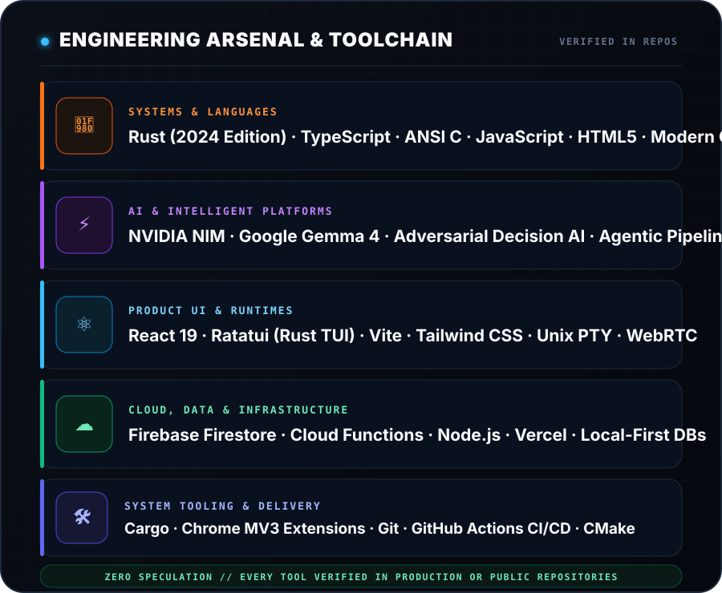
</p>

### 🛠️ Interactive Toolchain Matrix

<p align="center">
  <a href="https://www.rust-lang.org/"></a>
  <a href="https://www.typescriptlang.org/"></a>
  <a href="https://developer.mozilla.org/en-US/docs/Web/JavaScript"></a>
  <a href="https://en.wikipedia.org/wiki/C_(programming_language)"></a>
  <a href="https://developer.nvidia.com/nim"></a>
  <a href="https://react.dev/"></a>
  <a href="https://vitejs.dev/"></a>
  <a href="https://firebase.google.com/"></a>
  <a href="https://webrtc.org/"></a>
  <a href="https://nodejs.org/"></a>
  <a href="https://git-scm.com/"></a>
  <a href="https://github.com/features/actions"></a>
</p>

<br />

---

<a id="engineering-manifesto"></a>
<a id="-engineering-manifesto"></a>
<a id="engineering-loop"></a>
<a id="-engineering-loop"></a>

## 06 // ENGINEERING EXECUTION LOOP

<p align="center">
  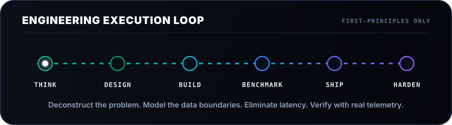
</p>

<details open>
<summary><strong>📐 Core Architectural Tenets</strong></summary>

<br />

1. **Useful Before Impressive:** Visual aesthetics matter immensely, but only when resting on a bedrock of rock-solid data integrity, bounded memory usage, and zero latency.
2. **Respect the Compute & Threads:** Avoid non-essential dependencies and endless abstraction layers. Profile memory allocations, keep worker threads non-blocking, and eliminate frame drops.
3. **Local-First & Resilient:** Software should retain core utility regardless of flaky networks. Data belongs to the user first.
4. **Adversarial Validation:** Don't just test happy paths. Intentionally bombard edge cases, simulate race conditions, and verify system behavior under high concurrency.

</details>

<br />

---

<a id="telemetry--activity"></a>
<a id="-telemetry--activity"></a>
<a id="activity"></a>
<a id="-activity"></a>

## 07 // CONTRIBUTION TELEMETRY & ACTIVITY

Activity metrics and contribution visualizations are pre-rendered and verified to ensure maximum reliability and zero external service dependency.

<div align="center">

  <picture>
    <source media="(prefers-color-scheme: dark)" srcset="assets/github-snake-dark.svg" />
    <source media="(prefers-color-scheme: light)" srcset="assets/github-snake.svg" />
    
  </picture>

  <sub>Automated via GitHub Actions cron workflow &nbsp;•&nbsp; Refreshed daily at 00:00 UTC</sub>

  <br /><br />

  <table border="0">
    <tr>
      <td>
        
      </td>
      <td>
        
      </td>
    </tr>
  </table>

  <br />

  

</div>

<br />

> **Telemetry Data Integrity & Freshness:**
> - **Arcade Defender Telemetry:** 53-week commit history ($53 \times 7 = 371$ days) compiled from GitHub GraphQL API, rendered into `assets/arcade/arcade_shooter.gif` with verified score formula ($\text{Base } 1,670 + \text{Bonus } 2,400 = 4,070\text{ PTS}$).
> - **Contribution Snake:** Refreshed daily at 00:00 UTC via `.github/workflows/snake.yml`.
> - **Dynamic Statistics Cards:** Real-time metrics served via GitHub API with fallback pre-rendered assets preventing broken image states.

<br />

---

<a id="roadmap"></a>
<a id="-roadmap"></a>

## 08 // STRATEGIC HORIZONS

<p align="center">
  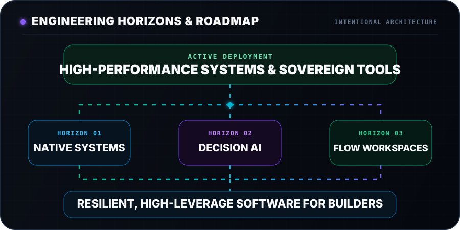
</p>

<br />

---

<a id="transmission"></a>
<a id="-transmission"></a>
<a id="contact"></a>
<a id="-contact"></a>

## 09 // TRANSMISSION & NETWORK

<div align="center">

  <h3>Interested in collaborating on high-performance systems or AI platforms?</h3>

  <p>Explore the codebases, audit the architectures, or open a discussion on GitHub.</p>

  <br />

  <a href="https://github.com/tace-x?tab=repositories">
    
  </a>
  &nbsp;&nbsp;
  <a href="https://github.com/tace-x">
    
  </a>

  <br /><br /><br />

  

</div>
