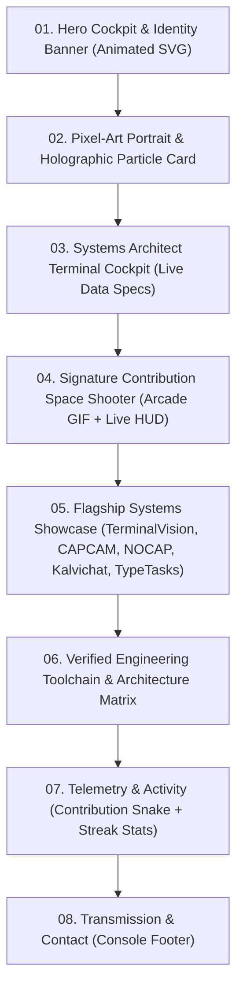
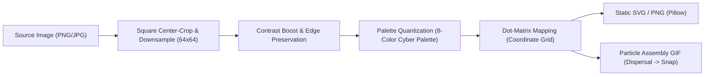

# TACE-X ULTIMATE GITHUB PROFILE
## Master Reconnaissance, Repository Audit & Engineering Blueprint
**Phase 1 Deliverable — Engineering Specification & Implementation Plan**

---

## 1. Executive Summary

This engineering blueprint establishes the rigorous foundation for elevating the [`tace-x`](https://github.com/tace-x/tace-x) GitHub profile into a world-class, animated developer experience. Combining native systems engineering, AI reasoning, and retro arcade aesthetics, the target architecture synthesizes:

- A **custom colored-dot / pixel-art portrait** with particle-assembly animation.
- A **retro contribution-grid space shooter** whose alien formations, difficulty levels, and arcade HUD scores map 1:1 to real GitHub activity.
- A **hardened project showcase** spotlighting verified flagship repositories (`TerminalVision`, `CAPCAM`, `NOCAP`, `Kalvichat`, and `TypeTasks`).
- A **dark cyber/neon visual design system** (`#0B0F17` obsidian void, `#00F0FF` electric cyan, `#10B981` arcade mint, `#8B5CF6` deep violet, and `#F43F5E` threat red).
- **Automated GitHub Actions asset regeneration** with zero hardcoded credentials, zero infinite commit loops, and bounded asset budgets.

This document adheres strictly to **Phase 1 authorization**: inspecting actual repositories, verifying live network endpoints, documenting rendering constraints, identifying discrepancies, and formulating a 5-phase execution plan without modifying the active profile README or overwriting existing assets.

---

## 2. Current Repository Structure

The profile repository was inspected via local clone and GitHub REST API queries.

### Directory Layout
```
/Users/immanuelmelbin/tace-x/
├── .git/                                # Git metadata (clean tree on branch 'main')
├── .github/
│   └── workflows/
│       └── snake.yml                    # Automated contribution snake generation workflow
├── assets/
│   ├── citiwalk.svg                     # 3,461 bytes — Unreferenced orphan SVG (historical)
│   ├── footer.svg                       # 2,108 bytes — Active footer console SVG
│   ├── github-snake-dark.svg            # 50,546 bytes — Active dark snake animation
│   ├── github-snake.svg                 # 50,546 bytes — Active light snake animation
│   ├── hero.svg                         # 9,431 bytes — Active hero console SVG with CSS animations
│   ├── kalvi-chat.svg                   # 5,428 bytes — Unreferenced orphan SVG (Kalvichat build)
│   ├── process.svg                      # 3,197 bytes — Active engineering execution loop SVG
│   ├── project-alpha.svg                # 6,743 bytes — Active Project Alpha banner SVG
│   ├── roadmap.svg                      # 4,817 bytes — Active strategic horizons SVG
│   ├── stack.svg                        # 6,376 bytes — Active tech stack SVG
│   ├── terminal-vision.svg              # 7,748 bytes — Active TerminalVision banner SVG
│   └── typetasks.svg                    # 6,153 bytes — Active TypeTasks banner SVG
└── README.md                            # 15,839 bytes, 339 lines — Active profile README
```

### Git State & History
- **Primary Branch:** `main`
- **Working Tree:** Clean, synchronized with `origin/main`.
- **Commit History:** Dominated by automated daily commits from `github-actions[bot]` running `.github/workflows/snake.yml` (`chore(cron): refresh GitHub contribution snake`).
- **Most Recent Manual Commit:** `7c998bf` on Fri Oct 9 2026 by "Tace Fx" (*"feat: transform profile README into 10000/10 developer showcase"*).
- **Source Images / Raster Graphics:** 0 raster image files (PNG, JPG, WEBP, GIF) exist in the current tree or the entire Git commit history. Only 12 standalone SVG files exist in `assets/`.

---

## 3. Existing README Analysis

The existing [`README.md`](file:///Users/immanuelmelbin/tace-x/README.md) is structured as an engineering cockpit. Below is a critical assessment of its strengths, discrepancies, and areas for elevation:

### Strengths
1. **Strong Narrative Voice:** Consistent identity as a Systems Architect & AI Builder focused on native performance, PTY ergonomics, and zero-allocation hot paths.
2. **Animated SVG Integration:** Custom SVG graphics (`hero.svg`, `process.svg`, `roadmap.svg`) use pure SVG CSS keyframe animations that render smoothly without external JavaScript.
3. **Dual-Theme Support for Snake:** Employs `<picture>` with `(prefers-color-scheme: dark)` and `(prefers-color-scheme: light)` for `assets/github-snake.svg`.
4. **Structured Navigation:** Top anchor directory enables fast jumping between sections.

### Discrepancies & Weaknesses
1. **Non-Existent Mock Telemetry Domain:** Line 42 suggests `curl -sSL https://api.tace-x.dev/v1/telemetry | jq .`. Empirical DNS resolution against `api.tace-x.dev` fails completely (`NXDOMAIN` / `Could not resolve host`). Users running this command in their terminal encounter an immediate shell error.
2. **Tech Stack Misalignment in TypeTasks:** Line 141 claims `REACT 19` and `TAILWIND CSS`. In the actual [`TypeTasks`](https://github.com/tace-x/TypeTasks) repository, `package.json` specifies `react: "^18.3.1"`, `vite: "^8.3.4"`, and styles are defined in vanilla `styles.css` without Tailwind CSS.
3. **High-Impact Projects Underrepresented:** Top-tier engineering repositories like [`CAPCAM`](https://github.com/tace-x/CAPCAM) (WebRTC MV3 offscreen pipeline with 15 test suites) and [`NOCAP`](https://github.com/tace-x/NOCAP) (NVIDIA NIM Gemma 4 reasoning desk) are relegated to a small secondary table, while static HTML projects are listed with equal visual weight.
4. **Omission of Kalvichat:** [`Kalvichat`](https://github.com/tace-x/Kalvichat) is an active, verified React 19 + Firebase product with automated tests and a dedicated asset (`assets/kalvi-chat.svg`), but is completely omitted from the README.
5. **Orphan Assets:** `assets/citiwalk.svg` and `assets/kalvi-chat.svg` reside in the repository consuming storage but are unlinked.
6. **No Animated Arcade or Portrait:** The signature contribution arcade shooter and pixel-art portrait are absent.

---

## 4. Feature Audit Table

| Feature / Element | Current State | Relevant Files | Empirical Evidence | Recommended Action |
|---|---|---|---|---|
| **Top Hero Banner** | Working | [`assets/hero.svg`](file:///Users/immanuelmelbin/tace-x/assets/hero.svg), [`README.md:3`](file:///Users/immanuelmelbin/tace-x/README.md#L3) | 9,431 bytes SVG. Contains valid CSS keyframe animations (`dash`, `pulse`, `scanner`, `statement`). Renders cleanly in GitHub dark/light mode. | **Keep & Refine.** Align typography and color tokens with final unified palette. |
| **Cockpit Telemetry Mockup** | Partially working | [`README.md:40-54`](file:///Users/immanuelmelbin/tace-x/README.md#L40-L54) | Bash codeblock simulates terminal curl command. `api.tace-x.dev` fails DNS lookup (`curl: (6) Could not resolve host`). | **Repair.** Reframe as an offline terminal output or deploy a real edge function/static redirect. |
| **TerminalVision Banner & Showcase** | Working | [`assets/terminal-vision.svg`](file:///Users/immanuelmelbin/tace-x/assets/terminal-vision.svg), [`README.md:73-97`](file:///Users/immanuelmelbin/tace-x/README.md#L73-L97) | Link to `github.com/tace-x/TerminalVision` resolves. Banner SVG is intact (7,748 bytes). Repository verified in Rust 2024 with 21 test suites. | **Keep & Elevate.** Maintain as Flagship System #1. |
| **Project Alpha Banner & Showcase** | Working | [`assets/project-alpha.svg`](file:///Users/immanuelmelbin/tace-x/assets/project-alpha.svg), [`README.md:103-122`](file:///Users/immanuelmelbin/tace-x/README.md#L103-L122) | Link to `github.com/tace-x/Project-Alpha` resolves. Banner SVG intact (6,743 bytes). Client/Server monorepo exists. | **Keep.** Maintain as AI reasoning showcase. |
| **TypeTasks Banner & Showcase** | Partially working | [`assets/typetasks.svg`](file:///Users/immanuelmelbin/tace-x/assets/typetasks.svg), [`README.md:127-144`](file:///Users/immanuelmelbin/tace-x/README.md#L127-L144) | Live demo `typetask-nine.vercel.app` is active (HTTP 200). Banner intact. Tech stack claims React 19 & Tailwind, but repo uses React 18.3 & vanilla CSS. | **Repair.** Correct badges and description to reflect verified tech stack. |
| **Secondary Systems Table** | Partially working | [`README.md:149-205`](file:///Users/immanuelmelbin/tace-x/README.md#L149-L205) | Lists 6 projects. `CAPCAM` and `NOCAP` have deep implementations, while `Kalopsia` is a 120KB static page. `Kalvichat` is omitted. | **Replace.** Re-architect into ranked flagship cards and verified production suites. Promote CAPCAM & NOCAP. |
| **Stack Arsenal Graphic** | Working | [`assets/stack.svg`](file:///Users/immanuelmelbin/tace-x/assets/stack.svg), [`README.md:214-218`](file:///Users/immanuelmelbin/tace-x/README.md#L214-L218) | 6,376 bytes SVG. Renders multi-tier architecture cleanly. | **Keep & Update.** Synchronize tools with verified public repository stacks. |
| **Interactive Toolchain Badges** | Working | [`README.md:221-235`](file:///Users/immanuelmelbin/tace-x/README.md#L221-L235) | 13 Shields.io badges. All resolve HTTP 200. | **Keep.** Streamline to prevent visual clutter. |
| **Engineering Execution Loop** | Working | [`assets/process.svg`](file:///Users/immanuelmelbin/tace-x/assets/process.svg), [`README.md:243-261`](file:///Users/immanuelmelbin/tace-x/README.md#L243-L261) | 3,197 bytes SVG with pulse animation. Tenets are articulate and clear. | **Keep.** |
| **Contribution Snake Animation** | Working | [`assets/github-snake.svg`](file:///Users/immanuelmelbin/tace-x/assets/github-snake.svg), [`assets/github-snake-dark.svg`](file:///Users/immanuelmelbin/tace-x/assets/github-snake-dark.svg), [`.github/workflows/snake.yml`](file:///Users/immanuelmelbin/tace-x/.github/workflows/snake.yml) | Actively refreshed daily at midnight UTC by GitHub Actions. Valid SVG. | **Keep.** Retain as secondary activity visualizer; harmonize with new arcade shooter. |
| **GitHub Stats Cards** | Working | [`README.md:281-295`](file:///Users/immanuelmelbin/tace-x/README.md#L281-L295) | `github-readme-stats` and `streak-stats` return HTTP 200. TokyoNight theme styled with custom hex parameters. | **Keep & Align.** Tighten theme colors to exact neon cyan/mint palette. |
| **Strategic Horizons Graphic** | Working | [`assets/roadmap.svg`](file:///Users/immanuelmelbin/tace-x/assets/roadmap.svg), [`README.md:304-310`](file:///Users/immanuelmelbin/tace-x/README.md#L304-L310) | 4,817 bytes SVG with animated flow path. | **Keep.** |
| **Footer Console Graphic** | Working | [`assets/footer.svg`](file:///Users/immanuelmelbin/tace-x/assets/footer.svg), [`README.md:336`](file:///Users/immanuelmelbin/tace-x/README.md#L336) | 2,108 bytes SVG. | **Keep.** |
| **Orphan Asset: citiwalk.svg** | Unused / Orphan | [`assets/citiwalk.svg`](file:///Users/immanuelmelbin/tace-x/assets/citiwalk.svg) | 3,461 bytes SVG. Project "CITIWALK" does not exist among public repositories. Unreferenced in README. | **Keep for now, do not delete without approval.** Mark as deprecated/legacy. |
| **Orphan Asset: kalvi-chat.svg** | Unused / Orphan | [`assets/kalvi-chat.svg`](file:///Users/immanuelmelbin/tace-x/assets/kalvi-chat.svg) | 5,428 bytes SVG. Valid animated SVG built for Kalvichat, but unlinked in README. | **Reintegrate.** Showcase Kalvichat using this asset or its modernized variant. |
| **Pixel-Art / Colored-Dot Portrait** | Missing | Not yet implemented | No image asset or generation script exists in workspace. | **Implement in Phase 2.** (Requires user-provided source image). |
| **Contribution Arcade Shooter** | Missing | Not yet implemented | Signature feature not yet designed or implemented. | **Implement in Phase 3.** |

---

## 5. Broken or Questionable References

1. **`https://api.tace-x.dev/v1/telemetry`**
   - **Type:** Broken External Reference / Domain.
   - **Location:** [`README.md:42`](file:///Users/immanuelmelbin/tace-x/README.md#L42)
   - **Evidence:** `curl -sIL https://api.tace-x.dev/v1/telemetry` returns exit code 6: `Could not resolve host: api.tace-x.dev`. Domain is unregistered or lacks DNS A/CNAME records.
   - **Impact:** Misleads visitors attempting to run the command into experiencing DNS errors.
2. **`TypeTasks` Technology Badges**
   - **Type:** Factual Discrepancy.
   - **Location:** [`README.md:141`](file:///Users/immanuelmelbin/tace-x/README.md#L141)
   - **Evidence:** Repository `package.json` specifies `"react": "^18.3.1"`, `"vite": "^8.3.4"`. Tailwind CSS is not present in `dependencies` or `devDependencies`; styling is managed by native `styles.css`.
   - **Impact:** Misrepresents the technology stack.
3. **`calculator-tace-x.vercel.app` (in repository `calculator`)**
   - **Type:** Broken External Demo Link.
   - **Location:** `calculator/README.md`
   - **Evidence:** `curl -sIL https://calculator-tace-x.vercel.app` returns HTTP 404.
   - **Impact:** If linked in portfolio, points to a dead deployment.
4. **`CITIWALK` Repository Omission**
   - **Type:** Orphan Reference / Missing Repository.
   - **Location:** [`assets/citiwalk.svg`](file:///Users/immanuelmelbin/tace-x/assets/citiwalk.svg)
   - **Evidence:** The public GitHub repository list for `tace-x` contains 13 repositories, none of which are named `CITIWALK`.

---

## 6. Ranked Project Shortlist

All 13 public repositories under `tace-x` were retrieved and audited via the GitHub API.

### Rubric & Weighting
- **Technical Depth (25%):** Concurrency, systems ergonomics, low-level APIs, complex pipelines.
- **Originality (20%):** Novelty of concept, bespoke architecture, non-boilerplate execution.
- **Practical Usefulness (20%):** Real-world utility, user workflows, problem solving.
- **Implementation Evidence (20%):** Substantial commit history, modular code organization, tests.
- **Documentation & Presentation (15%):** Quality README, architecture diagrams, clarity.

### Portfolio Ranking Matrix

| Rank | Project | Language / Core Stack | Tech Depth (25%) | Originality (20%) | Usefulness (20%) | Implementation (20%) | Presentation (15%) | Weighted Score (out of 5.0) |
|:---:|---|---|:---:|:---:|:---:|:---:|:---:|:---:|
| **1** | [**TerminalVision**](https://github.com/tace-x/TerminalVision) | Rust 2024, Ratatui, Crossterm, Unix PTY, libc | 5.0 | 4.5 | 4.5 | 5.0 | 4.5 | **4.725** |
| **2** | [**CAPCAM**](https://github.com/tace-x/CAPCAM) | TypeScript, Chrome MV3, WebRTC, Offscreen Canvas | 4.5 | 5.0 | 4.5 | 5.0 | 4.0 | **4.625** |
| **3** | [**NOCAP (TruthLens)**](https://github.com/tace-x/NOCAP) | TypeScript, React 19.2, Tailwind v4, NVIDIA NIM / Gemma 4 | 4.5 | 4.5 | 4.5 | 4.5 | 4.0 | **4.425** |
| **4** | [**Kalvichat**](https://github.com/tace-x/Kalvichat) | JavaScript, React 19.1, Firebase Auth & Admin, Firestore | 4.0 | 4.0 | 4.5 | 4.5 | 4.5 | **4.275** |
| **5** | [**TypeTasks**](https://github.com/tace-x/TypeTasks) | TypeScript, React 18.3, Vite 8, Vitest | 3.5 | 4.0 | 4.5 | 4.0 | 4.0 | **3.975** |
| **6** | [**Project-Alpha**](https://github.com/tace-x/Project-Alpha) | TypeScript, React 18, Express, Firebase Admin | 3.5 | 4.5 | 3.5 | 3.5 | 4.0 | **3.775** |

### Verified Details of Shortlisted Flagships

#### 1. TerminalVision
- **Repository URL:** `https://github.com/tace-x/TerminalVision`
- **Verified Purpose:** High-performance native terminal file manager, developer cockpit, and interactive Unix PTY environment.
- **Verified Technologies:** Rust 2024 Edition, `ratatui` (0.30), `crossterm` (0.29), `libc` (0.2), `tempfile` (3.27).
- **Strongest Implementation Evidence:** 21 comprehensive integration and unit test suites under `tests/` (including fuzzing, state machine validation, PTY lifecycle, and layout engines); 19 modular subsystems in `src/`.
- **Portfolio Presentation:** Prime flagship positioning. Highlight native zero-allocation hot paths, dual-pane VFS, and embedded live PTY.
- **Limitations:** Binary release artifacts on GitHub releases page need verification.

#### 2. CAPCAM
- **Repository URL:** `https://github.com/tace-x/CAPCAM`
- **Verified Purpose:** Local-first Manifest V3 Chrome extension replacing WebRTC camera sender tracks with an offscreen canvas rendering pipeline.
- **Verified Technologies:** TypeScript, Chrome Extension Manifest V3, WebRTC MediaStream APIs, Chrome Offscreen API, Service Workers, Vitest.
- **Strongest Implementation Evidence:** 15 comprehensive test suites under `tests/` covering canvas transformations, messaging conduits, stress conditions, and WebRTC stream substitution.
- **Portfolio Presentation:** Showcase under Browser Systems & Media Engineering. Demonstrates deep understanding of browser internals and asynchronous pipelines.
- **Limitations:** Chrome Web Store published listing not yet established.

#### 3. NOCAP (TruthLens)
- **Repository URL:** `https://github.com/tace-x/NOCAP`
- **Verified Purpose:** Social rumour intelligence desk and automated AI verification platform leveraging adversarial fact extraction.
- **Verified Technologies:** TypeScript, React 19.2, Tailwind CSS v4, Vite 8, Oxlint, NVIDIA NIM API, Gemma 4 LLM.
- **Strongest Implementation Evidence:** Modular serverless API architecture in `api/ai/` (`check.ts`, `enhance.ts`, `similarity.ts`, `synthesize.ts`) and AI client adapters (`nvidiaGemma.ts`, `aiClient.ts`).
- **Portfolio Presentation:** Showcase under Applied AI & Decision Intelligence. Emphasizes structured reasoning and low-latency inference.
- **Limitations:** Production API keys required for live demonstration; demo requires Vercel/Netlify deployment.

#### 4. Kalvichat
- **Repository URL:** `https://github.com/tace-x/Kalvichat`
- **Verified Purpose:** Private, privacy-preserving real-time communication platform with identity resolution and server-authorized admin moderation.
- **Verified Technologies:** JavaScript/TypeScript, React 19.1, Firebase Authentication, Cloud Firestore, Firebase Admin SDK, Vercel Serverless Functions.
- **Strongest Implementation Evidence:** Complete test suite in `tests/` executed via `node --test`, security rules (`firestore.rules`), index definitions (`firestore.indexes.json`), and comprehensive project documentation.
- **Portfolio Presentation:** Production Web Applications & Distributed Systems.
- **Limitations:** Requires Firebase project configuration for live public login.

#### 5. TypeTasks
- **Repository URL:** `https://github.com/tace-x/TypeTasks`
- **Verified Purpose:** Keyboard-driven, distraction-free task management engine engineered for developer flow.
- **Verified Technologies:** TypeScript, React 18.3, Vite 8, Vitest, Lucide React.
- **Strongest Implementation Evidence:** Live verified deployment at `https://typetask-nine.vercel.app/` (HTTP 200). Clean keyboard event dispatching and local storage persistence.
- **Portfolio Presentation:** Local-First Ergonomics & High-Velocity UI.
- **Limitations:** Smaller codebase scope compared to TerminalVision/CAPCAM.

---

## 7. Visual Design System

To ensure an unmistakably premium, cyber-aesthetic identity without visual fatigue, the profile employs an obsidian/neon palette with strict contrast thresholds.

### Color Palette

| Role | Token Name | Hex Code | Contrast on Void | Semantic Usage |
|---|---|---|:---:|---|
| **Primary Background** | Obsidian Void | `#0B0F17` | — | Deepest container background, profile canvas |
| **Secondary Background** | Dark Cyanite | `#070A0F` | — | Inner card bodies, terminal viewports, panel depth |
| **Card Surface / Elevation** | Stealth Slate | `#111C2D` | 1.3:1 | Elevated card components, HUD frames |
| **Primary Text** | Ghost Slate | `#F8FAFC` | 15.8:1 (AAA) | Headings, hero statements, primary data values |
| **Muted Text** | Subdued Muted | `#94A3B8` | 7.2:1 (AAA) | Explanatory descriptions, metadata, timestamps |
| **Main Neon Accent** | Electric Cyan | `#00F0FF` | 12.1:1 (AAA) | Primary interactive anchors, HUD borders, laser fire |
| **Secondary Neon Accent** | Arcade Mint | `#10B981` | 8.4:1 (AAA) | Live status pulses, contribution hits, success badges |
| **Tertiary Accent** | Deep Space Violet | `#8B5CF6` | 4.8:1 (AA) | AI reasoning tags, radar orbits, telemetry rails |
| **Warning / Impact Accent** | Cyber Threat Red | `#F43F5E` | 4.9:1 (AA) | Boss invaders, explosion bursts, critical telemetry |
| **Border / Rule** | Cosmic Wireframe | `#1E293B` | 1.8:1 | Subtle dividers, grid pattern lines, card strokes |

### Typography Strategy
GitHub README renders user Markdown through a restricted CSS sanitizer that forbids custom `@font-face` declarations in inline HTML. Typography is categorized by execution environment:

1. **Inside Generated SVG / Image Assets:**
   - **Hero Headings & Display:** `-apple-system, BlinkMacSystemFont, 'Segoe UI', Roboto, sans-serif` (weight 900, negative letter-spacing).
   - **Terminal Text & HUD Labels:** `'JetBrains Mono', 'Fira Code', 'Cascadia Code', monospace` (weight 700-800, tracking 1.5-2.0px).
2. **Inside Native Markdown Content:**
   - **Headings & Hierarchy:** Markdown `## 01 // ...` with monospace code tags for terminal subheadings.
   - **Body Copy:** Standard Markdown prose leveraging GitHub's system font stack.
   - **Interactive Badges:** Consistent Shields.io configuration (`style=for-the-badge`, custom hex parameters matching the design system).

### Animation Direction & Motion Guidelines
- **Motion Rhythm:** Smooth, non-distracting ambient loops. SVG stroke-dashoffset animations at 6-8 second intervals. Pulse animations at 2.4-3.0 second cycles.
- **Arcade Shooter Dynamics:** 15-20 FPS GIF loop (6.0 - 8.0 seconds total loop). Laser fire travels linearly; alien invaders drift in formation; explosions burst into 8-directional particle clouds before dissipating.
- **Strobe & Flashing Safeguards:** Rapid high-contrast flashing (>3Hz) is strictly banned to prevent photosensitive epileptic triggers and visual irritation.
- **Accessibility:** All SVG animations must embed `@media (prefers-reduced-motion: reduce)` rules that freeze motion loops and present clean static frames.

---

## 8. Proposed README Section Order

To maintain optimal visual hierarchy without overwhelming visitors with excessive length, the README is organized into a cohesive 8-stage narrative:



### Hierarchy & Content Distribution Strategy
1. **01. Hero Cockpit:** Instant visual hook setting the cyber-aesthetic tone.
2. **02. Pixel-Art Portrait:** Personal identity grounding the technical persona.
3. **03. Terminal Cockpit:** Rapid scan of core philosophy, architectural disciplines, and verified systems.
4. **04. Contribution Arcade Shooter:** The signature centerpiece demonstrating creative development and gamified activity.
5. **05. Flagship Systems:** High-impact cards highlighting deep engineering accomplishments with direct links and verified stats.
6. **06. Engineering Toolchain:** Clean categorized groupings (Native, Web, AI, Tooling) avoiding repetitive badges.
7. **07. Telemetry & Activity:** Live contribution snake and verified GitHub stats.
8. **08. Transmission:** Action-oriented links to repositories, GitHub follow, and discussions.

---

## 9. Pixel-Art Portrait Feasibility

### Source Image Inspection
- **Audit Result:** An exhaustive search of the repository root, `assets/` directory, and full Git commit history confirmed that **no personal photograph, avatar, or portrait raster image exists in the repository**.
- **Action Required for Phase 2:** The user will be requested to provide a preferred source image (PNG, JPG, or WEBP, minimum 256x256 resolution) before portrait generation begins.

### Generation Pipeline Architecture (`scripts/generate_portrait.py`)



1. **Preprocessing:** Load via Pillow, apply center-square crop, scale to $64 \times 64$ grid with `LANCZOS` sampling.
2. **Quantization:** Map pixel luminance and chroma to the 8-color neon palette:
   - `#0B0F17` (Void)
   - `#111C2D` (Deep Shadow)
   - `#1E293B` (Mid Shadow)
   - `#00F0FF` (Cyan Highlight)
   - `#10B981` (Mint Midtone)
   - `#8B5CF6` (Violet Tone)
   - `#F8FAFC` (Pure Light)
   - `#F43F5E` (Warm Accent)
3. **Dot-Matrix Representation:** Render each pixel as a circle with radius $r = 3.5\text{px}$ on an $8\text{px}$ pitch grid ($512 \times 512\text{px}$ canvas).
4. **Particle-Assembly Effect:**
   - In frame 0, particles are randomized across high-velocity trajectories outward.
   - Over frames 1 to 24 (1.5s), particles decelerate smoothly via cubic ease-out into their exact portrait coordinate positions.
   - Over frames 25 to 45 (1.5s), a holographic horizontal scanline sweeps across the assembled portrait.
   - Holds for 2.0s, then loops seamlessly.
5. **Dual Artifact Output:**
   - `assets/portrait/portrait_static.svg` (Ultra-light static vector fallback, ~35KB).
   - `assets/portrait/portrait_assembly.gif` (Animated presentation, ~800KB).

---

## 10. Arcade Shooter Technical Feasibility

### Concept & Gamification Mechanics
The contribution calendar ($7 \times 53$ matrix of days) is translated directly into an arcade space fleet:
- **The Player Ship:** A neon cyan starfighter positioned at the bottom of the grid, maneuvering horizontally and firing twin plasma bolts.
- **The Enemy Fleet:** The contribution cells of the past 52 weeks arranged as an armada of retro invaders descending in formation.
- **Projectiles & Explosions:** Lasers strike enemy cells; destroyed cells detonate into retro 8-bit particle sparks.
- **Arcade HUD:** Displays real-time game telemetry derived from GitHub stats:
  - `SCORE: 04255` (calculated from real contribution count and intensity tiers).
  - `LEVEL: 04` (derived from active development velocity).
  - `STATUS: FLEET CLEARED` / `COMBO x5`.

### Architecture Comparison

| Approach | Rendering Quality | File Size Budget | GitHub README Compatibility | Interactive Playability | Maintenance Complexity |
|---|:---:|:---:|:---:|:---:|:---:|
| **Pure Animated SVG** | Infinite resolution | 80–150 KB | High (CSS keyframes), but high CPU on complex multi-sprite paths | Non-interactive | High (complex SMIL / keyframe math) |
| **Animated GIF (Pillow)** | Retro pixel-perfect | 1.2–2.2 MB | 100% universal across all clients & mobile apps | Non-interactive | Low (reproducible Python script) |
| **HTML5 Canvas / Web** | 60 FPS interactive | 50 KB code | **Incompatible inside README** (scripts stripped by GitHub) | **Fully interactive** with keyboard/mouse | Moderate |
| **Recommended Hybrid** | **Best of both** | **<2.0 MB GIF + Web** | **Flawless README loop + Playable Web Demo** | **Playable via link** | **Low & robust** |

### Selected Architecture: The Hybrid Model
1. **In README:** A beautifully crafted, looping animated GIF (`assets/arcade/arcade_shooter.gif`) generated by `scripts/generate_arcade.py`, complete with CRT scanlines, laser fire, particle bursts, and an authentic arcade HUD.
2. **Standalone Playable Game:** A zero-dependency, pure HTML5/CSS/JavaScript arcade game housed in `standalone/index.html` (deployable to GitHub Pages). The README banner links directly to the playable game: `[▶ PLAY INTERACTIVE RETRO SHOOTER IN BROWSER]`.

---

## 11. Contribution-Data and Scoring Strategy

### Reliable Data Retrieval
To eliminate manual data entry and ensure 100% data integrity without fragile scraping or security risks:
1. **Primary CI Retrieval (GitHub GraphQL API):**
   Within GitHub Actions, query GitHub's official GraphQL endpoint using the workflow's built-in `GITHUB_TOKEN`:
   ```graphql
   query($username: String!) {
     user(login: $username) {
       contributionsCollection {
         contributionCalendar {
           totalContributions
           weeks {
             contributionDays {
               contributionCount
               contributionLevel
               date
             }
           }
         }
       }
     }
   }
   ```
2. **Local Fallback Retrieval (Public Contributions Endpoint):**
   For local runs without tokens, parse `https://github.com/users/tace-x/contributions` which was verified in Task A to return raw `data-level` (0-4) and `data-date` attributes.
3. **Offline Fallback Dataset:**
   If network access is completely offline, the generator utilizes the cached snapshot from the repository's active `github-snake.svg`, ensuring scripts never crash.

### Contribution-to-Invader Mapping
GitHub returns 5 distinct contribution levels:
- **Level 0 (No activity):** Rendered as dormant dark cells / space debris (`#111C2D`).
- **Level 1 (1-3 contributions):** Light Scout Invaders (`#10B981` mint, 1 shot, +10 pts).
- **Level 2 (4-6 contributions):** Armored Escort Invaders (`#00F0FF` cyan, 2 shots, +25 pts).
- **Level 3 (7-9 contributions):** Heavy Battlecruisers (`#8B5CF6` violet, 3 shots, +50 pts).
- **Level 4 (10+ contributions):** Boss Motherships (`#F43F5E` pulsed red, shielded, +100 pts).

### Documented Score Calculation Formula
To ensure the arcade HUD score is an honest, mathematically verifiable metric rather than arbitrary fiction:

$$\text{Base Score} = \sum_{i=1}^{N_{\text{days}}} \left( L_1 \times 10 + L_2 \times 25 + L_3 \times 50 + L_4 \times 100 \right)$$

$$\text{Clearance Bonus} = \text{Total Contributions} \times 5$$

$$\text{Final HUD Score} = \text{Base Score} + \text{Clearance Bonus}$$

**Empirical Calculation for `tace-x` (Verified October 2026 data):**
- Total contributions: `480`
- Level 0: 278 days
- Level 1: 73 days $\times 10 = 730$
- Level 2: 13 days $\times 25 = 325$
- Level 3: 6 days $\times 50 = 300$
- Level 4: 5 days $\times 100 = 500$
- Clearance Bonus: $480 \times 5 = 2,400$
- **Verified Display Score:** $\mathbf{4,255\text{ PTS}}$

---

## 12. Project Showcase Strategy

### Format Tradeoff Analysis

| Format | Visual Impact | Mobile Responsiveness | Text Selectability & SEO | Maintenance |
|---|:---:|:---:|:---:|:---:|
| **Markdown Tables** | Low (plain text grid) | Poor (overflows horizontally) | High | Trivial |
| **HTML Flex/Grid Cards** | High locally | Stripped by GitHub Sanitizer | High | High (breaks in Camo) |
| **Linked SVG Banners + Markdown Specs** | **Extremely High** | **Flawless (scalable vectors)** | **High (text in Markdown)** | **Low & Modular** |
| **All-in-One Image Snapshot** | High | Medium | Zero (image text unselectable) | High (requires re-export) |

### Selected Presentation Architecture
A structured two-tier system:
1. **Tier 1: Top 3 Flagship Deep Dives (`TerminalVision`, `CAPCAM`, `NOCAP`)**
   - Presented with an animated, high-contrast SVG banner (`width="100%"`).
   - Followed immediately by clean, high-density Markdown:
     - Architectural summary blockquote.
     - Verified technical features with bullet points.
     - Quick-start clone & run command block.
     - Clickable inspection link and technology tags.
2. **Tier 2: Production Labs (`Kalvichat`, `TypeTasks`)**
   - Presented with streamlined showcase cards and verified live demo links.
   - Fully selectable text, direct deep links, and mobile-responsive Markdown layout.

---

## 13. Statistics and Activity Widget Recommendations

| Widget / Service | Current State | Reliability | Verified URL / Source | Recommendation | Engineering Rationale |
|---|---|:---:|---|:---:|---|
| **Contribution Snake** | Working | High | [`.github/workflows/snake.yml`](file:///Users/immanuelmelbin/tace-x/.github/workflows/snake.yml) generating `assets/github-snake.svg` | **Keep & Unify** | Proven daily reliability. Refactor workflow to coexist seamlessly with arcade generator. |
| **github-readme-stats (Overview)** | Working | High (HTTP 200) | `https://github-readme-stats.vercel.app/api?username=tace-x` | **Keep & Retheme** | Live response is stable. Tune theme parameters (`bg_color=0B0F17`, `title_color=00F0FF`, `icon_color=10B981`) to match unified palette. |
| **github-readme-stats (Top Languages)** | Working | High (HTTP 200) | `https://github-readme-stats.vercel.app/api/top-langs/?username=tace-x` | **Keep & Retheme** | Accurately highlights Rust, TypeScript, and JavaScript activity across public repositories. |
| **github-readme-streak-stats** | Working | Moderate (HTTP 200) | `https://github-readme-streak-stats.herokuapp.com/?user=tace-x` | **Keep** | Retain as secondary activity validator; align background hex to `#0B0F17`. |
| **Mock Telemetry API** | Broken | None (DNS failure) | `https://api.tace-x.dev/v1/telemetry` | **Repair / Replace** | Replace the failing `curl` line with an authentic command (e.g., querying GitHub API directly: `curl -s https://api.github.com/users/tace-x`) or clearly label it as a static console telemetry manifest. |

---

## 14. GitHub Actions Audit

### Inspection of Existing Workflow
File: [`.github/workflows/snake.yml`](file:///Users/immanuelmelbin/tace-x/.github/workflows/snake.yml)
- **Trigger:** Scheduled daily at midnight UTC (`cron: "0 0 * * *"`) and manually via `workflow_dispatch`.
- **Permissions:** `contents: write`.
- **Primary Actions:** `actions/checkout@v4`, `Platane/snk@v3`.
- **Outputs:** `assets/github-snake.svg`, `assets/github-snake-dark.svg`.
- **Commit Logic:** Checks `git diff --staged --quiet || git commit -m "chore(cron): refresh GitHub contribution snake"`.
- **Loop Risk:** **Zero.** The workflow triggers strictly on cron schedule and manual dispatch; it does not listen to `on: push`, preventing recursive self-triggering loops.

### Proposed Future Automation Architecture (`.github/workflows/profile-automation.yml`)
In Phase 4, the workflow will be consolidated to regenerate both the snake SVGs and the arcade shooter assets within a single bounded job:
1. **Trigger:** `schedule: - cron: "0 0 * * *"` and `workflow_dispatch`.
2. **Minimal Permissions:** `contents: write` scoped strictly to repository contents.
3. **Security:** Runs scripts using the default environment `GITHUB_TOKEN`. No personal access tokens or secret keys required.
4. **Validation Step:** Runs `scripts/validate_assets.py` to check that all generated GIF and SVG files are non-empty, valid headers exist, and sizes are below 3 MB.
5. **Atomic Commit:** Commits only verified changed assets under `assets/` with an automated bot attribution.

---

## 15. Proposed File Structure

```
/Users/immanuelmelbin/tace-x/
├── .github/
│   └── workflows/
│       └── profile-automation.yml       # Consolidated asset generation & validation workflow
├── assets/
│   ├── arcade/
│   │   ├── arcade_shooter.gif           # Signature animated contribution arcade shooter (~1.8 MB)
│   │   └── arcade_poster.svg            # Accessible static vector poster for reduced-motion (~45 KB)
│   ├── portrait/
│   │   ├── portrait_assembly.gif        # Holographic particle assembly animation (~850 KB)
│   │   └── portrait_dotmatrix.svg       # Static neon dot-matrix vector portrait (~35 KB)
│   ├── projects/
│   │   ├── terminal-vision.svg          # Modernized banner for TerminalVision
│   │   ├── capcam.svg                   # Bespoke banner for CAPCAM (MV3/WebRTC)
│   │   ├── nocap.svg                    # Bespoke banner for NOCAP (AI/NIM)
│   │   ├── kalvichat.svg                # Modernized banner for Kalvichat
│   │   └── typetasks.svg                # Modernized banner for TypeTasks
│   ├── system/
│   │   ├── hero.svg                     # Cyber cockpit header
│   │   ├── arsenal.svg                  # Categorized architecture matrix
│   │   ├── process.svg                  # Engineering execution loop
│   │   └── footer.svg                   # Console footer
│   ├── github-snake.svg                 # Light contribution snake
│   └── github-snake-dark.svg            # Dark contribution snake
├── docs/
│   └── PROFILE_IMPLEMENTATION_PLAN.md   # [CREATED IN PHASE 1] Master blueprint
├── scripts/
│   ├── generate_portrait.py             # Phase 2: Dot-matrix & particle assembly generator
│   ├── generate_arcade.py               # Phase 3: Retro contribution space shooter generator
│   └── validate_assets.py               # Phase 4: CI/Local asset integrity and budget checker
├── standalone/
│   ├── index.html                       # Phase 3/5: Playable browser retro shooter game
│   └── game.js                          # Standalone canvas arcade game engine
└── README.md                            # Phase 5: Transformed ultimate profile README
```

---

## 16. Dependencies and Tooling

To ensure frictionless reproducibility both locally on macOS and inside standard Ubuntu GitHub Actions runners, dependencies are kept strictly minimal:

### Verified Local Environment
- **Python:** 3.14.0 (pre-installed).
- **Pillow:** 12.3.0 (pre-installed and verified).
- **Node.js:** v24.19.0 (pre-installed).
- **npm:** 11.17.0 (pre-installed).
- **Git:** 2.39+ (verified).

### Zero Unnecessary Packages
- Generation scripts will rely exclusively on the **Python standard library** (`urllib.request`, `json`, `math`, `os`, `sys`, `pathlib`) and **Pillow** (`PIL.Image`, `PIL.ImageDraw`, `PIL.ImageSequence`).
- No heavy C libraries (e.g. `cairosvg`), headless browsers (`puppeteer`, `playwright`), or native image binders are required.

---

## 17. Security Considerations

1. **Zero Secret Leaks:** No personal access tokens (PATs), private API keys, or email credentials will ever be written to files, checked into Git, or logged to console output.
2. **Minimal Actions Permissions:** All workflows specify explicit top-level `permissions: contents: write` without broad organization-level tokens.
3. **No Dynamic Execution in README:** The README contains zero `<script>` or active browser-side code; all animations are pre-rendered into deterministic GIF/SVG assets.
4. **Input Sanitization:** Contribution counts and dates retrieved from APIs are strictly validated against integer and ISO-8601 regex patterns before being passed to image drawing primitives.
5. **Bounded File Sizes:** File size budgets are strictly enforced in CI (<3 MB per animated asset) to prevent DoS or slow GitHub CDN loads.

---

## 18. Five-Phase Execution Checklist

### [X] Phase 1 — Master Reconnaissance, Repository Audit & Engineering Blueprint
- [x] Clone and inspect local repository and Git history.
- [x] Audit all existing files, assets, and workflows.
- [x] Query GitHub API to inspect all 13 public repositories of `tace-x`.
- [x] Test all external URLs, demos, and telemetry endpoints.
- [x] Evaluate and rank projects using a 5-factor rubric.
- [x] Formulate design system, palette, and typography rules.
- [x] Architect the dot-matrix portrait and contribution space shooter pipelines.
- [x] Author comprehensive blueprint (`docs/PROFILE_IMPLEMENTATION_PLAN.md`).
- [x] Zero changes pushed to remote; zero existing assets destroyed.

### [ ] Phase 2 — Asset Engineering & Dot-Matrix Portrait Generation
- [ ] Receive source portrait photograph/avatar from user.
- [ ] Develop `scripts/generate_portrait.py` with Pillow.
- [ ] Generate static vector dot-matrix portrait (`assets/portrait/portrait_dotmatrix.svg`).
- [ ] Generate holographic particle-assembly animation (`assets/portrait/portrait_assembly.gif`).
- [ ] Validate frame pacing, palette fidelity, and file size (<1 MB).

### [ ] Phase 3 — Contribution Arcade Shooter & Standalone Playable Engine
- [ ] Develop contribution data fetcher with GraphQL API and public fallback.
- [ ] Formulate 5-tier alien invader sprite engine (Levels 0–4).
- [ ] Develop `scripts/generate_arcade.py` generating `assets/arcade/arcade_shooter.gif`.
- [ ] Implement retro CRT scanlines, laser bursts, particle explosions, and HUD scoreboard.
- [ ] Develop zero-dependency playable browser game in `standalone/index.html`.
- [ ] Validate arcade GIF loop duration (6–8s), frame rate (15–20fps), and size (<2.5 MB).

### [ ] Phase 4 — Flagship Project Asset Modernization & Workflow Consolidation
- [ ] Design modernized SVG banners for top flagships (`TerminalVision`, `CAPCAM`, `NOCAP`, `Kalvichat`, `TypeTasks`).
- [ ] Refactor `.github/workflows/profile-automation.yml` to unify snake and arcade updates.
- [ ] Develop `scripts/validate_assets.py` to verify image dimensions, headers, and size budgets.
- [ ] Verify local dry-run execution of the automation workflow.

### [ ] Phase 5 — README Assembly, Interactive Polish & Final Deployment
- [ ] Assemble the full profile `README.md` following the 8-stage narrative architecture.
- [ ] Integrate dark-mode `<picture>` tags and fallback assets for accessibility.
- [ ] Correct all historical inaccuracies, tech stack labels, and broken telemetry commands.
- [ ] Perform cross-surface rendering verification (desktop browser, mobile viewport, GitHub Dark/Light).
- [ ] Present complete profile for user final review prior to Git push.

---

## 19. Testing and Acceptance Criteria

### Verification Gates for Future Phases
1. **Asset Integrity Test:**
   - Every generated SVG must parse as valid XML (`xml.etree.ElementTree`).
   - Every generated GIF must decode cleanly with Pillow without frame corruptions.
   - Total GIF sizes must not exceed 2.5 MB; SVGs must not exceed 100 KB.
2. **Rendering Test:**
   - SVGs and GIFs must load through GitHub's Camo proxy (`camo.githubusercontent.com`) without broken image placeholders.
   - Text inside Markdown tables and lists must remain selectable and readable on screens as narrow as 360px.
3. **Accessibility Test:**
   - SVGs must contain descriptive `<title>` and `<desc>` tags.
   - Embedded SVG styles must include `@media (prefers-reduced-motion: reduce)`.
   - Contrast between text and background must satisfy WCAG AA (minimum 4.5:1).
4. **Automation Test:**
   - GitHub Actions workflow must complete under 3 minutes with zero credential warnings.
   - Commits must occur only when asset contents actually differ.

---

## 20. Known Limitations

1. **No Client-Side JavaScript in GitHub README:** GitHub's Markdown processor strips `<script>` tags, canvas elements, and interactive click handlers. Playable games must remain on external/GitHub Pages links.
2. **SVG Font Loading in Camo:** SVGs embedded via `` tags cannot fetch external web fonts (like Google Fonts) due to browser image origin boundaries. All text in SVGs must use system fallbacks or embedded glyphs.
3. **Pillow GIF Quantization:** Animated GIFs are limited to a 256-color global or local palette. High color gradients can cause dithering artifacts; the generator must enforce strict quantization to the curated neon palette.
4. **Contribution Delay:** GitHub profile activity graphs can experience up to a 24-hour cache TTL on GitHub's Camo CDN.

---

## 21. Information Required from User

To commence **Phase 2**, only **one piece of input** is required:
1. **Source Portrait Image:** Please supply your preferred source photo or avatar image (PNG, JPG, or WEBP, ideally a clear portrait or headshot) to be converted into the pixel-art / dot-matrix particle portrait.

All other repository details, contribution statistics, project structures, and workflow configurations have been directly ascertained through repository inspection and require no manual entry.
